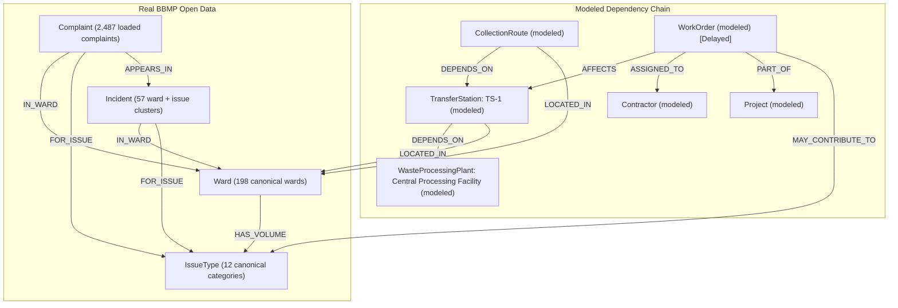

# 🏙️ CivicGraph: Bangalore Municipal Grievance Intelligence Engine

[](https://civicgraph-ai.streamlit.app/)
🌐 **Live Application:** [https://civicgraph-ai.streamlit.app/](https://civicgraph-ai.streamlit.app/)

CivicGraph is a graph-native municipal intelligence and root-cause tracing platform for Bangalore (BBMP) civic grievances. It integrates real open grievance data with a synthetic municipal dependency graph to investigate civic breakdowns, compute split evidence scores, and simulate downstream cascading impacts.

---

## 📌 Data Provenance & Reporting Methodology

> [!NOTE]
> **Data Provenance Legend**:
> - **Real Data (BBMP Open Data)**: Ward boundaries (198 canonical wards), grievance records (`Complaint ID`, `Grievance Date`, `Category`, `Sub Category`, `Grievance Status`), and year-over-year grievance volumes.
> - **Synthetic Modeling**: Individual complaint descriptions (including 20% Kannada texts flagged `language='kn'`), municipal infrastructure nodes, work orders, and contractors ending in `(modeled)`.
> - **Reporting Channels**: Grievance volumes reflect **registered complaints**, which may include growth in citizen reporting channels.

### Like-for-Like Timeframe
All year-over-year comparative analytics evaluate the exact like-for-like window:
$$\text{H1 2024 vs H1 2025 (Jan 1 – Jun 19)}$$
- **Citywide Benchmark**: Registered complaints increased by **+63.99%** across all 198 wards (+64.38% for Solid Waste Management).
- Full-year 2024 totals are retained purely as supplementary context.

### Real Story Anchor: Thanisandra Solid Waste Management Spike
- **Spike Window**: Week 24, 2025 (Jun 9 – Jun 15, 2025).
- **Volume Surge**: 141 registered complaints in a single week.
- **Unpolluted Weekly Baseline**: **36.8 registered complaints/week** (calculated strictly excluding the spike week).
- **Spike Multiplier**: **3.83x** historical unpolluted baseline.
- **Loaded Window**: Jun 6 – Jun 19, 2025 (all 2,487 complaints across top 8 wards loaded without sampling caps).

---

## 🏗️ Graph Architecture & Schema

CivicGraph operates safely within Neo4j Aura Free tier limits (**2,773 nodes** and **12,042 relationships**):



### Stable Identifiers & Relationship Nomenclature
- **Stable Incident IDs**: `INC-<WardName>-<IssueSlug>` without spaces (e.g., `INC-Thanisandra-SolidWaste`, `INC-Horamavu-RoadMaintenance`).
- **Approved Relationship Types**: `IN_WARD`, `FOR_ISSUE`, `APPEARS_IN`, `HAS_VOLUME`, `DEPENDS_ON`, `AFFECTS`, `ASSIGNED_TO`, `PART_OF`, `MAY_CONTRIBUTE_TO`.
- `(WorkOrder)-[:MAY_CONTRIBUTE_TO]->(IssueType)` only (never directly linked to `Incident`).
- Wording constraint: strictly "is associated with" or "may contribute to" (never "caused by", "due to", or "confidence").

---

## ⚖️ Evidence Scoring Engine (Split Real vs Modeled)

Every incident is evaluated with a split evidence score (maximum **95 points**):

### 1. Real-Data Evidence (Maximum 40 points)
1. **`count_gte_10` (+15 pts)**: Incident contains $\ge 10$ registered complaints in the 14-day loaded window.
2. **`spike_vs_baseline` (+15, +10, or +5 pts)**: Weekly volume surge relative to the ward + issue's own weekly baseline excluding the spike week ($\ge 3.0\text{x} \implies +15$, $\ge 2.0\text{x} \implies +10$, $\ge 1.5\text{x} \implies +5$).
3. **`volume_up_vs_citywide` (+10 pts)**: Ward's like-for-like % change strictly exceeds the citywide same-issue trend.

### 2. Modeled-Link Evidence (Maximum 55 points)
4. **`delayed_work_order_in_ward` (+25 pts)**: A delayed work order directly affects infrastructure located in the incident ward.
5. **`may_contribute_to_matches_issue` (+15 pts)**: Work order relationship `MAY_CONTRIBUTE_TO` matches the issue and affects the ward or its dependent catchment infrastructure.
6. **`downstream_dependency_connected` (+15 pts)**: Incident ward is actively connected to the infrastructure dependency chain (`DEPENDS_ON*1..3`).

> **Evidence Disclaimer**: *"Work order is a synthetic model; association is not causation. Growth in reporting channels may play a role."*

---

## 🔍 Core Graph Queries

1. **`find_incidents(ward=None, issue_type=None)`**:
   Returns incidents grouped by ward and issue type with registered complaint counts, open vs resolved resolution status, and stable IDs. Case-insensitive matching.

2. **`trend_for_ward(ward_name)`**:
   Returns H1 2024 vs H1 2025 registered complaints per issue type, ward % change, citywide same-issue benchmark, and percentage points vs citywide.

3. **`top_rising_issues(limit=5)`**:
   Discovers ward and issue pairs experiencing the fastest surge in registered grievances across Bangalore against same-issue benchmarks.

4. **`trace_root_cause(incident_id)`**:
   Evaluates delayed work orders contributing to an incident's issue type, computes the split evidence score (Real-data vs Modeled-link), and traces downstream dependents.

5. **`what_if_delay(work_order_id, extra_days=14)`**:
   Traverses `DEPENDS_ON*1..3` upstream/downstream infrastructure dependencies and tallies real grievances in the connected catchment area.

---

## 🤖 Bilingual Assistant (Kannada & English)

CivicGraph incorporates native Kannada municipal inquiry support using Sarvam AI translation (`mayura:v1`) and multi-turn tool calling:
- Automatically detects Kannada queries (`\u0C80-\u0CFF`).
- Translates Kannada queries to English for graph tool execution.
- Translates English answers to Kannada while preserving technical terms.
- Returns all 4 audit fields: `original_question`, `english_translation`, `english_answer`, and `kannada_answer`.

---

## 🚀 Setup & Reproduction

### 1. Environment Configuration
Create a `.env` file in the root directory:
```env
NEO4J_URI=neo4j+s://<instance-id>.databases.neo4j.io
NEO4J_USERNAME=neo4j
NEO4J_PASSWORD=<password>
NEO4J_DATABASE=neo4j
OPENAI_API_KEY=<optional-for-gpt-4o-mini>
SARVAM_API_KEY=<sarvam-api-key>
```

### 2. Prepare Data
Cleans `data/bbmp_grievances_2024.csv` and `data/bbmp_grievances_2025.csv`, derives like-for-like volumes, computes ward baselines excluding spike weeks, and prepares clean records:
```bash
.\venv\Scripts\python.exe prepare_data.py
```

### 3. Load to Neo4j
Creates unique constraints and loads real complaints and the synthetic infrastructure layer:
```bash
.\venv\Scripts\python.exe load_real_data.py
```

### 4. Run the Dashboard
Access the live deployed application at **[https://civicgraph-ai.streamlit.app/](https://civicgraph-ai.streamlit.app/)**, or launch locally:
```bash
.\venv\Scripts\streamlit.exe run app.py
```

---

## 📊 Application Tabs

1. **📊 City Overview**: Headline KPIs (+63.99% citywide growth, 2,487 loaded complaints, 57 incidents) and like-for-like Top 8 Wards table.
2. **⚠️ Active Incidents**: Interactive incident table with ward/issue filters, stable incident IDs, and complaint drilldown inspector.
3. **🔍 Root Cause Tracing**: Live graph traversal linking incident clusters to delayed work orders with split evidence scores (Real-data: X/40, Modeled-link: Y/55, Total: Z/95).
4. **⚡ What-If Analysis**: Simulation measuring real citizen grievance exposure across dependent catchment areas when a facility faces maintenance delays.
5. **📈 Year-Over-Year Trends**: Interactive charts and data tables comparing H1 2024 vs H1 2025 registered complaints against same-issue citywide benchmarks.
